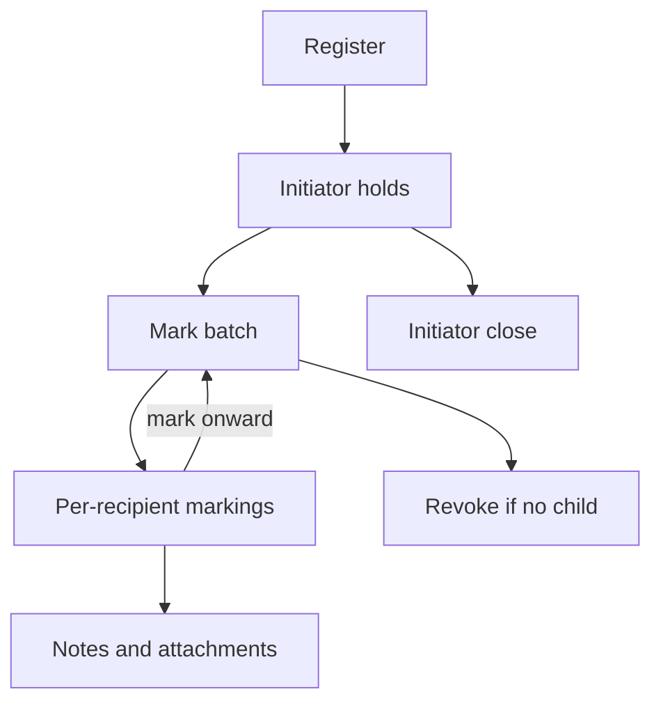
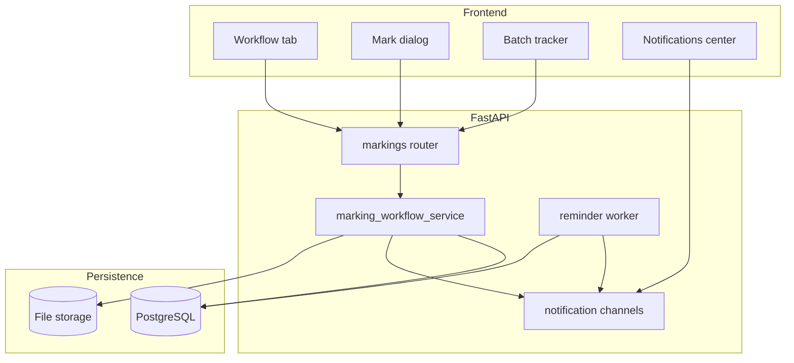

# Simple Marking Workflow — Master Implementation Plan

**Status:** PROPOSED / IMPLEMENTING on `feature/simple-marking-workflow`  
**Precondition:** Read `00-current-state.md`.

---

## 1. Target model

Correspondence is a **tree of markings** rooted at the initiator—not a long letter status enum.

```text
Register (manual or AI)
        ↓
Initiator holds letter (status Open)
        ↓
Mark batch → one or more recipients (Forward | For Info | Response Required)
        ↓
Each recipient may: add notes/attachments, fulfill Response Required,
                    mark onward (unlimited), or marker may Revoke (if no child marks)
        ↓
When initiator holds again (or still holds) → Close (soft warn if open RR)
```



### Letter-level statuses (v1)

| Status | Meaning |
|--------|---------|
| `Open` | In circulation |
| `Closed` | Initiator closed |
| `Archived` | Existing archive path |

Inbox/outbox derive from **active markings**, not enterprise statuses.

### Locked product defaults

- Replace enterprise lifecycle (not coexist).
- Initiator closes while they **hold**; soft warning if open `response_required` remain.
- Any non-Viewer holder may mark to any user.
- Viewer: read-only.

---

## 2. Action catalog (v1)

| Action | Obligation | Notes |
|--------|------------|-------|
| `forward` | None | Movement only |
| `for_info` | None (optional soft ack later) | FYI |
| `response_required` | Must submit response | Requires `response_type`; optional `due_at` |

**Response types:** `draft_letter`, `presentation`, `nominations`, `comments`, `other` (+ free text when other).

**Attachment kinds:** `Presentation`, `Draft Response`, `Supporting Doc`, `Nomination List`, `Other`.

---

## 3. Invariants

1. Initiator immutable for v1 (`created_by` / `initiator_user_id`).
2. Markings are append-only rows; revoke = status change, never delete.
3. Every mark / note / attachment / revoke / close stamped with UTC datetime + client IP.
4. Self-mark forbidden; duplicate active A→B rejected.
5. Closed letter: no new marks/notes (Admin reopen out of v1 unless reused).
6. LLM/OCR never writes markings; only creates the letter at intake.
7. In-app notification always on mark-to-user; email channel provisioned, enabled via config later.

---

## 4. Dependency map



| Dependency | Notes |
|------------|-------|
| PostgreSQL | New marking tables |
| Existing `cms_notifications` | In-app delivery |
| `cms_reminder_log` pattern | Reminder dedupe |
| Document upload / storage | Note attachments |
| SMTP settings (optional) | Email channel stub |

---

## 5. Spec index (implementation order)

| Spec | File | Implements |
|------|------|------------|
| 01 | `specs/01-domain-model.md` | Entities, enums, letter fields |
| 02 | `specs/02-marking-and-revoke.md` | Mark batch, chain, revoke, IP |
| 03 | `specs/03-inputs-and-attachments.md` | Notes, files, RR fulfillment |
| 04 | `specs/04-tracking-and-close.md` | Track flag, batch tracker, close |
| 05 | `specs/05-notifications-reminders-email.md` | Notify, pathway, reminders, SMTP |
| 06 | `specs/06-api-and-access.md` | REST + access + inbox/sent |
| 07 | `specs/07-ui-workflow-tab.md` | Workflow tab UX |
| 08 | `specs/08-migration-and-deprecation.md` | Schema cutover, enterprise sunset |
| 09 | `specs/09-testing-and-acceptance.md` | E2E / acceptance |

**Git convention on this branch:** one commit per spec (docs and/or code that implements that spec).

---

## 6. Phased build order

1. Spec docs (this pack).  
2. Domain schema + marking service (specs 01–04 core).  
3. API + access (spec 06).  
4. UI Workflow tab (spec 07).  
5. Notifications / reminders / email provision (spec 05).  
6. Migration + deprecation + tests (specs 08–09).

---

## 7. Out of scope for v1

- Multi-tier departmental approval chains.
- External dispatch channels as a separate lifecycle.
- Email delivery to Outlook (provision only).
- Changing initiator after register.
- Full org-chart forced routing.
